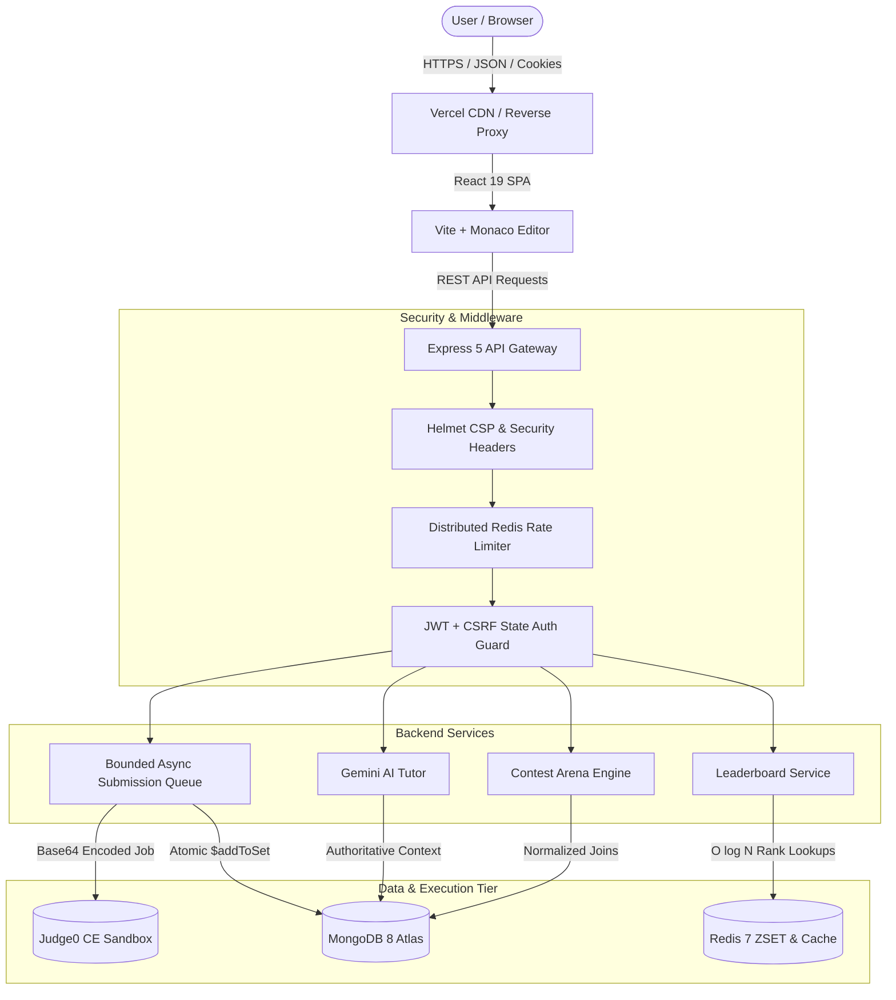

<div align="center">

# XCODE
**Production-Ready Online Judge & Competitive Coding Platform**

[](https://github.com/Hunterx15/x_code/actions)
[](https://react.dev/)
[](https://expressjs.com/)
[](https://www.mongodb.com/)
[](https://redis.io/)
[](https://judge0.com/)
[](https://ai.google.dev/)
[](https://www.docker.com/)
[](LICENSE)

[Live Web Application](https://x-code-ruddy.vercel.app) &bull; [Interview Preparation Guide](file:///Users/pankajjangid/coding/WebDev/x_code/INTERVIEW_GUIDE.md) &bull; [API Endpoints](#api-architecture) &bull; [Load Benchmarks](#load-testing--benchmarks) &bull; [Local Setup](#getting-started)

</div>

---

## Overview

**XCODE** is a full-stack competitive programming and online judge platform built with Node.js, Express, React, MongoDB, Redis, Docker, and Judge0. It features a curated **66-problem DSA catalog** across 10 algorithmic categories with **100% video tutorial coverage**, a Monaco-powered IDE supporting C++, Java, and JavaScript, hostable **Contest Arenas** with ICPC penalty scoring, a DB-grounded **Gemini AI tutor**, and a **Redis Sorted Set (`ZSET`)** global leaderboard.

The platform is engineered with a strict focus on backend resilience: asynchronous bounded-concurrency execution (`202 Accepted`), atomic database solve tracking, distributed rate limiting, and graceful fail-open Redis degradation.

---

## System Architecture



---

## Core Engineering Features

### 1. Asynchronous Code Execution Pipeline (`202 Accepted`)
- **Decoupled Processing:** Code grading is detached from synchronous HTTP request threads using an in-memory bounded worker queue ([submissionQueue.js](file:///Users/pankajjangid/coding/WebDev/x_code/backend/src/utils/submissionQueue.js)).
- **Immediate Response:** `POST /submission/submit/:id` immediately returns `202 Accepted` with `{ submissionId, status: "pending" }`.
- **Backpressure Protection:** Configured with `MAX_CONCURRENCY = 5` and `MAX_QUEUE_DEPTH = 100`, returning `503 Service Unavailable` with `Retry-After: 5` under heavy load.
- **Client Polling:** Frontend polls `GET /submission/status/:id` with automatic retry cancellation on unmount.

### 2. High-Performance Redis Sorted Sets (`ZSET`) Leaderboard
- **Logarithmic Complexity:** Replaced $\mathcal{O}(N)$ MongoDB `$sort` pagination with Redis Sorted Sets where score is `problemSolved.length`.
  - Pagination (`zRangeWithScores`): $\mathcal{O}(\log N + K)$
  - Exact User Rank (`zRevRank`): $\mathcal{O}(\log N)$
- **Single-Flight Hydration:** Distributed lock pattern (`ensureHydrated`) queries MongoDB once on cold starts to populate the ZSET, preventing cache stampedes.
- **Fail-Open Resilience:** Configured with `disableOfflineQueue: true` and `isReady` guards; falls back transparently to MongoDB aggregations if Redis drops.

### 3. Contest Arena with ICPC Weighted Scoring
- **Normalized Schema:** Eliminates document size limits by replacing embedded arrays with a dedicated `ContestRegistration` collection with compound index `{ contestId: 1, userId: 1 }`.
- **ICPC Penalty Algorithm:**
  $$\text{Penalty} = \sum (\text{Solve Time in Minutes from Start} + 5 \times \text{Wrong Submissions})$$
- **Virtual Practice:** Real-time problem lockouts that unlock at contest `startTime`, with virtual contest practice modes.

### 4. 66-Problem DSA Catalog & 100% Video Editorial Coverage
- **Comprehensive Topics:** Array, String, Dynamic Programming, Graph, Tree, Binary Search, Linked List, Math, Greedy, and Hash Map.
- **Complete Video Solutions:** Every single problem (66/66) includes verified video walkthroughs (NeetCode / Striver) embedded in a responsive 16:9 player with clipboard copying and direct YouTube links.
- **Multi-Language Templates:** Canonical starter templates and reference solutions for C++, Java, and JavaScript.

### 5. Security & Authentication Hardening
- **OAuth 2.0 CSRF State Nonce:** 32-byte cryptographic random nonces stored in Redis (10m TTL) verified on callback.
- **60-Second Code Exchange:** Single-use exchange codes (`oauth:exchange:<id>`) prevent exposing JWT tokens in browser redirect URLs.
- **Prompt-Injection Mitigation:** AI Tutor ignores client-supplied problem text; fetches authoritative title, constraints, and test cases directly from MongoDB.
- **Distributed Rate Limiting:** Atomic Redis `INCR` + `EXPIRE` limits auth attempts, Gemini queries, and submission rates.

---

## Load Testing & Benchmarks

Benchmarked locally using our zero-dependency benchmark runner ([run-benchmark.js](file:///Users/pankajjangid/coding/WebDev/x_code/backend/loadtests/run-benchmark.js)) with persistent HTTP keep-alive connection pooling:

### A/B Read Throughput (100 Concurrent Virtual Users, 20s Duration)

| Configuration | Throughput (Req/s) | Avg Latency | p50 Latency | p95 Latency | p99 Latency | Error Rate |
| :--- | :---: | :---: | :---: | :---: | :---: | :---: |
| **MongoDB Baseline** (`DISABLE_REDIS=true`) | 1,221.1 req/s | 65.1 ms | 60.3 ms | 106.9 ms | 157.4 ms | **0.00%** |
| **Redis Cached** | **2,147.4 req/s** | **46.5 ms** | **43.0 ms** | **61.3 ms** | **121.7 ms** | **0.00%** |
| **Net Improvement** | **+75.9%** | **-28.6%** | **-28.7%** | **-42.7%** | **-22.7%** | **Rock Solid** |

### 5-Minute Endurance Soak Test (25 Concurrent Virtual Users)

```
=== XCODE Load Benchmark: Soak Test ===
Duration       : 300s (5 minutes)
Concurrency    : 25 VUs (Mixed read/write load)
Total Requests : 341,478 requests (1,138.2 req/s / 68,292 req/min)
Status Codes   : {"200": 341478}
Network Errors : 0 (0.00% error rate)
Latency        : min: 5.2 ms | avg: 22.0 ms | p50: 17.7 ms | p95: 44.5 ms | p99: 73.8 ms
```

---

## Tech Stack

| Layer | Technologies |
| :--- | :--- |
| **Frontend** | React 19, Vite 6, Tailwind CSS 4, Monaco Editor, Lucide Icons, Redux Toolkit |
| **Backend** | Node.js 22, Express 5, Mongoose 8, Redis 7 (`node-redis` v5), Helmet, Axios |
| **Judging Sandbox** | Judge0 CE (C++ 54, Java 62, JavaScript 63) |
| **AI Tutoring** | Google Gemini 1.5 Flash (DB-grounded context prompting) |
| **Infrastructure** | Docker, Docker Compose, Vercel (Frontend), Render (Backend), MongoDB Atlas |
| **CI / CD** | GitHub Actions (Unit testing, linting, Vite production build check) |

---

## Getting Started

### Prerequisites
- Node.js 20+ installed
- Docker & Docker Compose installed

### 1. Clone & Install Dependencies
```bash
git clone https://github.com/Hunterx15/x_code.git
cd x_code

# Install backend dependencies
cd backend && npm install

# Install frontend dependencies
cd ../frontend && npm install
```

### 2. Configure Environment Variables
Copy `.env.example` in both directories:
```bash
cp backend/.env.example backend/.env
cp frontend/.env.example frontend/.env
```

### 3. Start Infrastructure via Docker
```bash
docker compose up -d mongo redis
```

### 4. Seed Database & Run the Platform
```bash
# Seed 66 problems and attach all YouTube video solutions:
cd backend
node src/utils/seedYouTubeVideos.js

# Start backend server (Port 3000)
npm run dev

# Start frontend application (Port 5173) in a new terminal:
cd ../frontend
npm run dev
```

---

## Testing & Quality Assurance

### Run Native Node Unit Tests
```bash
cd backend
npm test
```
```
✔ cookieOptions uses SameSite=lax and secure=false in development
✔ cookieOptions defaults to SameSite=none and secure=true in production
✔ clearCookieOptions strips maxAge for Express 5 clearCookie compatibility
✔ no leftover git merge conflict markers exist in backend/src or frontend/src
✔ every backend JS file passes Node syntax check
✔ no frontend module has duplicate default exports
✔ validator enforces mandatory fields, valid email, and strong password
✔ problemUtility maps supported languages to Judge0 CE language IDs
✔ BADGE_DEFINITIONS evaluators accurately score milestones
✔ extractYouTubeId correctly parses standard, short, embed, and query YouTube URLs
ℹ tests 11 | pass 11 | fail 0
```

### Run Load Benchmarks
```bash
cd backend
# Seed synthetic benchmark users:
node loadtests/seed-loadtest-users.js

# Run 100-VU catalog benchmark:
node loadtests/run-benchmark.js --mode=problems --vus=100 --duration=20
```

---

## License

This project is licensed under the [ISC License](LICENSE).
